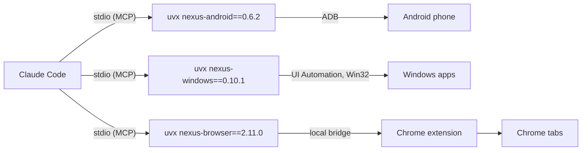

# Nexus plugins for Claude Code

[](https://github.com/pironjulien/nexus-plugins/actions/workflows/test.yml)
[](https://github.com/pironjulien/nexus-plugins/blob/main/LICENSE)

**Computer use in the background for Claude Code.** A plugin marketplace with three plugins that give Claude your
Android phone, your Windows desktop apps and your real Chrome, while you keep working. Each plugin starts an
open-source MCP server from PyPI with `uvx`, pinned to an exact version (versions and hashes in a `uv.lock`), and adds a skill that teaches Claude how to
use it.

| Plugin | What Claude gets | Server |
| --- | --- | --- |
| `nexus-android` | Your Android phone over plain ADB (no root, no app): screen, gestures, SMS/RCS, notifications, files, settings | [NexusAndroid](https://github.com/pironjulien/NexusAndroid) · [PyPI](https://pypi.org/project/nexus-android/) |
| `nexus-windows` | Windows desktop apps in the background: look, click, type, menus, shortcuts, launch, without your mouse or foreground | [NexusWindows-Claude](https://github.com/pironjulien/NexusWindows-Claude) · [PyPI](https://pypi.org/project/nexus-windows/) |
| `nexus-browser` | Your real Chrome with your sessions, in background tabs: forms, network, dialogs, iframes, exports, downloads | [NexusBrowser](https://github.com/pironjulien/NexusBrowser) · [PyPI](https://pypi.org/project/nexus-browser/) |

## Quick start

1. Install [uv](https://docs.astral.sh/uv/) (it fetches Python 3.14 and the servers on first use).
2. In Claude Code, add the marketplace and install the plugins you want:

   ```text
   /plugin marketplace add pironjulien/nexus-plugins
   /plugin install nexus-android@nexus-plugins
   /plugin install nexus-windows@nexus-plugins
   /plugin install nexus-browser@nexus-plugins
   ```

3. Start a new conversation and ask, for example: *"Look at my phone and tell me what is on the screen."* or
   *"Open Notepad and write a shopping list."*

More examples, and how to test each plugin without your own phone or data, are in each plugin's README
([nexus-android](https://github.com/pironjulien/nexus-plugins/tree/main/plugins/nexus-android#try-it),
[nexus-windows](https://github.com/pironjulien/nexus-plugins/tree/main/plugins/nexus-windows#try-it),
[nexus-browser](https://github.com/pironjulien/nexus-plugins/tree/main/plugins/nexus-browser#try-it)).

Per-plugin requirements:

- **nexus-android**: Android Platform Tools (`winget install Google.PlatformTools`), USB debugging on the phone and
  the PC's key accepted.
- **nexus-windows**: Windows 10 or 11.
- **nexus-browser**: the **NexusBrowser Chrome extension and local bridge**, installed once from
  [its repository](https://github.com/pironjulien/NexusBrowser#install) (Windows, Chrome 116+). Without them the
  server starts but every call answers with an error pointing to that install.

## How it works



Each plugin is a folder with a manifest, an icon, a `.mcp.json` launcher, a `pyproject.toml` with its `uv.lock`, and a
skill. Updating a plugin moves its pin to the
new server version, checked by `test.ps1 -Full` (the server is started from PyPI and lists its tools).

## Safeguards

Held by the servers, not by the prompt: paying, sending, publishing, deleting for good and other irreversible
gestures need your explicit "yes" (`confirm=true`); password fields are never typed into; text read on screen is
treated as data, never as instructions; an emergency stop (**Ctrl+Alt+Shift+Esc**) halts the desktop and browser
tools for two minutes. Details in each server's README.

## Privacy

- This repository contains no code that runs on your PC besides the launchers: `uvx --python 3.14
  <package>==<version>`, with the versions and hashes of the package and its dependencies recorded in the plugin's
  `uv.lock`. uv downloads Python 3.14 and the package from PyPI and caches them in uv's cache.
- The plugins send nothing anywhere. The servers run locally and return what they read (screen, messages, pages) to
  your Claude client only; what each server reads, stores (logs, screenshots) and how to remove it is in its
  README's Privacy section: [NexusAndroid](https://github.com/pironjulien/NexusAndroid#privacy),
  [NexusWindows-Claude](https://github.com/pironjulien/NexusWindows-Claude#privacy),
  [NexusBrowser](https://github.com/pironjulien/NexusBrowser#privacy).
- Removing everything: uninstall the plugins (`/plugin uninstall <name>@nexus-plugins`), remove the marketplace
  (`/plugin marketplace remove nexus-plugins`), then `uv cache clean`.

## Development

```powershell
pwsh -NoProfile -File test.ps1         # offline: manifests, pins, skills, nothing local or private
pwsh -NoProfile -File test.ps1 -Full   # plus: every server started from PyPI in a throwaway uv cache
```

## License

[MIT](https://github.com/pironjulien/nexus-plugins/blob/main/LICENSE) © Julien Piron
