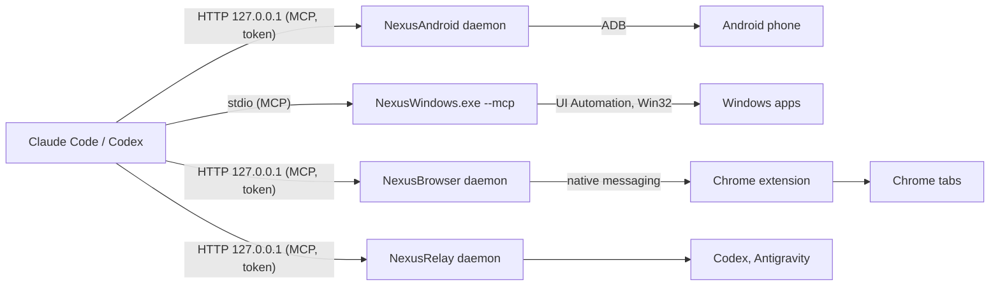

# NexusSystem

The hub and installer of the Nexus ecosystem (every product is optional, à la carte):

- **The NexusSystem app (recommended)** from the [Microsoft Store](https://apps.microsoft.com/detail/9NSH2P3QLWT1)
  (or `winget install --id 9NSH2P3QLWT1 --source msstore`): tick the products you want à la carte, install them in one
  click, follow each server's live state and 24-hour activity log, and use the emergency stop.
- **Ask your AI**: paste one sentence into **Claude Code**, **Codex** or **Antigravity** and let it install, verify and
  guide you through the products you want:
  ```text
  Install Nexus for me by following https://raw.githubusercontent.com/pironjulien/NexusSystem/main/INSTALL-AI.md
  ```
- **This repository**: the pack script `get-nexus.ps1` (a file of each release, checked, then run), [`INSTALL-AI.md`](INSTALL-AI.md), and the plugin catalogs for Claude Code and Codex (catalog name `nexus-plugins`, kept so that existing installs keep working). The app and the AI guide run the same `get-nexus.ps1`. The app's own source (WinUI 3, .NET 10) is in [`app/`](app/README.md).
This repository was called `nexus-plugins` until 28/10/2026; GitHub redirects the old address.

[](https://github.com/pironjulien/NexusSystem/actions/workflows/test.yml)
[](https://scorecard.dev/viewer/?uri=github.com/pironjulien/NexusSystem)
[](https://github.com/pironjulien/NexusSystem/blob/main/LICENSE)

## Install

Pick only the products you want (`windows`, `browser`, `android`, `relay`, `keypad`, `agymail`) or install everything that fits your PC (Claude Code, Claude Desktop, Codex, Antigravity). Windows 10 or 11, no administrator rights, nothing to install first.

### Option A — The NexusSystem app

Install [NexusSystem from the Microsoft Store](https://apps.microsoft.com/detail/9NSH2P3QLWT1), or in PowerShell
`winget install --id 9NSH2P3QLWT1 --source msstore`, open it, tick the products and click Install.

### Option B — Tell your AI (Claude Code, Codex, Antigravity)

Paste into your AI chat (adjust the product names if you only want specific ones):

```text
Install and set up NexusWindows and NexusBrowser for me by following https://raw.githubusercontent.com/pironjulien/NexusSystem/main/INSTALL-AI.md
```

### Option C — The pack script, by hand

Download the script as a file from the latest release, check it, then run it (never pipe downloaded code into
PowerShell: antivirus heuristics rightly flag that). In **PowerShell**, in a folder of your choice:

```powershell
$r = 'https://github.com/pironjulien/NexusSystem/releases/latest/download'
Invoke-WebRequest "$r/get-nexus.ps1" -OutFile get-nexus.ps1
Invoke-WebRequest "$r/SHA256SUMS.txt" -OutFile SHA256SUMS.txt
(Get-FileHash get-nexus.ps1 -Algorithm SHA256).Hash   # must match the get-nexus.ps1 line of SHA256SUMS.txt
gh attestation verify get-nexus.ps1 --repo pironjulien/NexusSystem   # optional: proof it was built here
powershell -NoProfile -ExecutionPolicy Bypass -File .\get-nexus.ps1
```

Or right click the downloaded `get-nexus.ps1` > **Run with PowerShell** (on Windows 11: **Show more options** first);
the window stays open at the end until you press Enter.
It shows which AI apps it found and what it will install for each, installs Git when Claude Code or Codex needs it to
add this catalog (Windows asks once), gives Claude Code and Codex the plugins of this catalog, then runs each product's
own official native installer (`get.ps1` of its repository). No Python, no uv: every product is a native Windows
engine (win-x64 and win-arm64), downloaded from its GitHub release and checked against its `SHA256SUMS.txt`.

| Product | Claude Code | Claude Desktop | Codex | Antigravity |
| --- | --- | --- | --- | --- |
| NexusWindows | plugin `nexus-windows` (this catalog) | [NexusWindows](https://github.com/pironjulien/NexusWindows) `get.ps1` | plugin `nexus-windows` (this catalog) | NexusWindows `get.ps1` (a plugin) |
| NexusAndroid | plugin `nexus-android` + daemon ([NexusAndroid](https://github.com/pironjulien/NexusAndroid) `get.ps1`) | NexusAndroid `get.ps1` | plugin `nexus-android` | NexusAndroid `get.ps1` (a plugin) |
| NexusBrowser | plugin `nexus-browser` + daemon ([NexusBrowser](https://github.com/pironjulien/NexusBrowser) `get.ps1`) | NexusBrowser `get.ps1` | plugin `nexus-browser` | NexusBrowser `get.ps1` (a plugin) |
| NexusRelay (experimental) | plugin `nexus-relay` + daemon ([NexusRelay](https://github.com/pironjulien/NexusRelay) `get.ps1`) | not a relay client | plugin `nexus-relay` | NexusRelay `get.ps1` (a plugin) |
| NexusAGYmail | official Gmail connector instead | official Gmail connector instead | official Gmail connector instead | [NexusAGYmail](https://github.com/pironjulien/NexusAGYmail) `get.ps1` (a plugin) |
NexusKeypad, for Logitech's MX Creative Keypad, is installed by [its own `get.ps1`](https://github.com/pironjulien/NexusKeypad)
when Logi Options+ is there (also on the Logitech Marketplace, in review).

It ends with a ✓ / ✗ summary per product and per AI app, then the steps only you can do: load the NexusBrowser
extension in Chrome (the installer opens the page and tells you what to click), turn on USB debugging on your phone,
add the relay's project in Codex once, connect your own Google account to NexusAGYmail, place the keypad's keys, and
restart your AI apps. A product that does not fit this PC (no Antigravity, no Logi Options+…) is shown, with why. Run the same line again to update or repair: every installer only does what is missing.

After installation, NexusSystem checks published updates in the background and retries deferred Windows and
Browser updates. Installation and activation are reported separately: a working AI connection keeps its state
until it can normally reload. See [Updates](UPDATES.md) for distribution, verification and the separate Chrome
Web Store update cycle.

Options: `-Only` and `-Skip` take product names (`windows`, `android`, `browser`, `relay`, `agymail`, `keypad`) or AI app names (`claude-code`,
`claude-desktop`, `codex`, `antigravity`); `-DryRun` shows the plan and installs nothing. Each product has one installer for every AI app: it is told the AI apps
chosen here and adds no second server beside a plugin. For example:

```powershell
powershell.exe -NoProfile -ExecutionPolicy Bypass -File .\get-nexus.ps1 -Only windows,browser
```

Each product also installs alone: see its README. Per-PC choices in `%USERPROFILE%\.nexus\nexussystem.json`, for
example `{"skip":["claude-desktop"]}`, are added to `-Skip` and respected by the app.

## The plugins, one by one

**Computer use in the background for Claude Code and Codex.** Five plugins for Claude Code (Android, Windows, Chrome,
the Relay between AI apps, the Logitech keypad) and four for Codex. Each includes its guide and reaches its product's
native engine, installed by NexusSystem (the app or the line above) or by the product's own `get.ps1`:

| Plugin | What the AI gets | Reaches |
| --- | --- | --- |
| `nexus-android` | Your Android phone over plain ADB (no root, no app): screen, gestures, SMS/RCS, notifications, files, settings | the [NexusAndroid](https://github.com/pironjulien/NexusAndroid) daemon, `127.0.0.1:16180` |
| `nexus-windows` | Windows desktop apps in the background: look, click, type, menus, shortcuts, launch, without your mouse or foreground | the [NexusWindows](https://github.com/pironjulien/NexusWindows) engine, `%USERPROFILE%\.nexus\nexus-windows\NexusWindows.exe` |
| `nexus-browser` | Your real Chrome with your sessions, in background tabs: forms, network, dialogs, iframes, exports, downloads | the [NexusBrowser](https://github.com/pironjulien/NexusBrowser) daemon, `127.0.0.1:16182` |
| `nexus-relay` | A direct line between Claude, Codex and Antigravity: topic rooms, reviews, delegated tasks | the [NexusRelay](https://github.com/pironjulien/NexusRelay) daemon, `127.0.0.1:16181` |
| `nexus-keypad` (Claude Code) | Live states and exact usage for the Logitech MX Creative Keypad, peers' reachability under the prompt | [NexusKeypad](https://github.com/pironjulien/NexusKeypad)'s native helper |

The daemons accept only local connections carrying the access token their installer creates; the plugins read it from
your user variable `NEXUS_MCP_TOKEN` and never contain it.

## Quick start

1. Install the products with NexusSystem (the app, or the PowerShell line above): it installs the engines and adds the
   plugins for you. To add the plugins by hand instead, Claude Code and Codex add a marketplace with Git: on a PC
   without it, `winget install --id Git.Git -e` first.
2. In Claude Code, add the marketplace and install the plugins you want:

   ```text
   /plugin marketplace add pironjulien/NexusSystem
   /plugin install nexus-android@nexus-plugins
   /plugin install nexus-windows@nexus-plugins
   /plugin install nexus-browser@nexus-plugins
   /plugin install nexus-relay@nexus-plugins
   /plugin install nexus-keypad@nexus-plugins
   ```

3. Start a new conversation and ask, for example: *"Look at my phone and tell me what is on the screen."* or
   *"Open Notepad and write a shopping list."*

Enabling the plugins by editing `settings.json` instead (`extraKnownMarketplaces` and `enabledPlugins`, user scope):
Claude installs an enabled plugin when a conversation starts, and only from a marketplace already downloaded at that
moment. The first conversation after declaring the marketplace downloads it, the next one installs the plugins, and
their tools appear in the conversation after that. Enabling them for one project only does not install them.

### Codex

The installer adds the Codex plugins from this marketplace, with their tools and guides. It uses Codex's installed,
OpenAI-signed desktop engine when the CLI is not on PATH. It keeps disabled products, custom MCP declarations and
plugins from another catalog; it migrates only the official installers' direct declarations (today's or a former
one) after the installed plugin and its guide have been verified. It never adds a second server beside a custom one.

The same repository is a Codex plugin marketplace (`.agents/plugins/marketplace.json`): `nexus-windows`,
`nexus-android`, `nexus-browser` and `nexus-relay`, the same native forms as for Claude Code (Codex reads no variable
in a plugin's command, so `nexus-windows` starts the engine from its stable folder through `cmd.exe`). In the Codex
app: **Settings > Plugins > Add > Add a marketplace**, source `pironjulien/NexusSystem`, then install the plugins; or
from a terminal:

```text
codex plugin marketplace add pironjulien/NexusSystem
codex plugin add nexus-windows@nexus-plugins
codex plugin add nexus-android@nexus-plugins
codex plugin add nexus-browser@nexus-plugins
codex plugin add nexus-relay@nexus-plugins
```

Antigravity's plugins are written by each product's own installer, in Antigravity's plugin folder.

Each plugin lives in one folder of its product's repository, `plugin/`, shared by the three AI apps; both catalogs
point to it at the product's release. More examples are in each product's README
([NexusAndroid](https://github.com/pironjulien/NexusAndroid#readme),
[NexusWindows](https://github.com/pironjulien/NexusWindows#readme),
[NexusBrowser](https://github.com/pironjulien/NexusBrowser#readme)).

## How it works



Each plugin is a folder with a manifest, an icon, a `.mcp.json` declaration (or hooks, for the keypad) and a skill.
`test.ps1` checks every declaration against the exact native form.
## Safeguards

Held by the servers, not by the prompt: paying, sending, publishing, deleting for good and other irreversible
gestures need your explicit "yes" (`confirm=true`); password fields are never typed into; text read on screen is
treated as data, never as instructions; an emergency stop (**Ctrl+Alt+Shift+Esc**) halts the desktop and browser
tools for two minutes. Details in each server's README.

## Privacy

- This repository contains no code that runs on your PC besides the declarations of each plugin and the keypad's
  modules: the engines and daemons are each product's own native release, installed by its `get.ps1`.
- The plugins send nothing anywhere. The servers run locally and return what they read (screen, messages, pages) to
  your AI app only; what each server reads, stores (logs, screenshots) and how to remove it is in its README's Privacy
  section: [NexusAndroid](https://github.com/pironjulien/NexusAndroid#privacy),
  [NexusWindows](https://github.com/pironjulien/NexusWindows#privacy),
  [NexusBrowser](https://github.com/pironjulien/NexusBrowser#privacy).
- Removing everything: uninstall the plugins (`/plugin uninstall <name>@nexus-plugins`), remove the marketplace
  (`/plugin marketplace remove nexus-plugins`), then each product as its README explains.

## Development

```powershell
pwsh -NoProfile -File test.ps1   # PowerShell lint, then dotnet test: catalogs, pack dry runs (Windows PowerShell 5.1), app
```

`dotnet test --solution NexusSystem.slnx` from the repository root runs the same tests (xUnit v3); build and test output
go to `~\.nexus\build\NexusSystem`, never into the repository.
## License

[MIT](https://github.com/pironjulien/NexusSystem/blob/main/LICENSE) © Julien Piron
