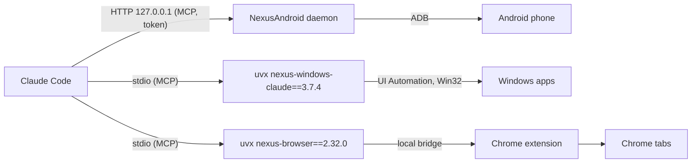

# NexusSystem

The hub and installer of the Nexus ecosystem (every product is optional, à la carte):

- **The NexusSystem app (recommended)** from the [Microsoft Store](https://apps.microsoft.com/detail/9NSH2P3QLWT1)
  (or `winget install --id 9NSH2P3QLWT1 --source msstore`): tick the products you want à la carte, install them in one
  click, follow each server's live state and 24-hour activity log, and use the emergency stop.
- **Ask your AI**: paste one sentence into **Claude Code**, **Codex** or **Antigravity** and let it install, verify and
  guide you through the products you want:
  ```text
  Install Nexus for me by following https://raw.githubusercontent.com/pironjulien/NexusSystem/main/INSTALL-AI.md
  ```
- **This repository**: the pack script `get-nexus.ps1` (a file of each release, checked, then run), [`INSTALL-AI.md`](INSTALL-AI.md), and the plugin catalogs for Claude Code and Codex (catalog name `nexus-plugins`, kept so that existing installs keep working). The app and the AI guide run the same `get-nexus.ps1`. The app's own source (WinUI 3, .NET 10) is in [`app/`](app/README.md).
This repository was called `nexus-plugins` until 28/10/2026; GitHub redirects the old address.

[](https://github.com/pironjulien/NexusSystem/actions/workflows/test.yml)
[](https://scorecard.dev/viewer/?uri=github.com/pironjulien/NexusSystem)
[](https://github.com/pironjulien/NexusSystem/blob/main/LICENSE)

## Install

Pick only the products you want (`windows`, `browser`, `android`, `relay`, `keypad`, `agymail`) or install everything that fits your PC (Claude Code, Claude Desktop, Codex, Antigravity). Windows 10 or 11, no administrator rights, nothing to install first.

### Option A — The NexusSystem app

Install [NexusSystem from the Microsoft Store](https://apps.microsoft.com/detail/9NSH2P3QLWT1), or in PowerShell
`winget install --id 9NSH2P3QLWT1 --source msstore`, open it, tick the products and click Install.

### Option B — Tell your AI (Claude Code, Codex, Antigravity)

Paste into your AI chat (adjust the product names if you only want specific ones):

```text
Install and set up NexusWindows and NexusBrowser for me by following https://raw.githubusercontent.com/pironjulien/NexusSystem/main/INSTALL-AI.md
```

### Option C — The pack script, by hand

Download the script as a file from the latest release, check it, then run it (never pipe downloaded code into
PowerShell: antivirus heuristics rightly flag that). In **PowerShell**, in a folder of your choice:

```powershell
$r = 'https://github.com/pironjulien/NexusSystem/releases/latest/download'
Invoke-WebRequest "$r/get-nexus.ps1" -OutFile get-nexus.ps1
Invoke-WebRequest "$r/SHA256SUMS.txt" -OutFile SHA256SUMS.txt
(Get-FileHash get-nexus.ps1 -Algorithm SHA256).Hash   # must match the get-nexus.ps1 line of SHA256SUMS.txt
gh attestation verify get-nexus.ps1 --repo pironjulien/NexusSystem   # optional: proof it was built here
powershell -NoProfile -ExecutionPolicy Bypass -File .\get-nexus.ps1
```

Or right click the downloaded `get-nexus.ps1` > **Run with PowerShell** (on Windows 11: **Show more options** first);
the window stays open at the end until you press Enter.
It shows which AI apps it found and what it will install for each, installs [uv](https://docs.astral.sh/uv/) when a
product still served from PyPI needs it (and Git when a Claude Code or Codex plugin needs it, Node.js LTS when Codex is
there; Windows asks once), then runs each product's own official installer: the `get.ps1` file of its latest release,
checked against that release's `SHA256SUMS.txt`, run with `-File`:

| Product | Claude Code | Claude Desktop | Codex | Antigravity |
| --- | --- | --- | --- | --- |
| NexusWindows | plugin `nexus-windows` (this catalog) | [NexusWindows](https://github.com/pironjulien/NexusWindows/tree/main/claude) `setup.ps1` | plugin `nexus-windows` ([NexusWindows](https://github.com/pironjulien/NexusWindows/tree/main/codex)) | [NexusWindows](https://github.com/pironjulien/NexusWindows/tree/main/agy) plugin |
| NexusAndroid | plugin `nexus-android` + daemon ([NexusAndroid](https://github.com/pironjulien/NexusAndroid) native `get.ps1`) | NexusAndroid `get.ps1` | same | same (a plugin) |
| NexusBrowser | plugin `nexus-browser` + bridge | [NexusBrowser](https://github.com/pironjulien/NexusBrowser) `get.ps1` | same | same (a plugin) |
| NexusRelay (experimental) | plugin `nexus-relay` + daemon ([NexusRelay](https://github.com/pironjulien/NexusRelay) native `get.ps1`) | not a relay client | same | same (a plugin) |
| NexusAGYmail | official Gmail connector instead | official Gmail connector instead | official Gmail connector instead | [NexusAGYmail](https://github.com/pironjulien/NexusAGYmail) native `get.ps1` (a plugin) |

NexusKeypad, for Logitech's MX Creative Keypad, is installed by [its own `get.ps1`](https://github.com/pironjulien/NexusKeypad)
when Logi Options+ is there (also on the Logitech Marketplace, in review).

It ends with a ✓ / ✗ summary per product and per AI app, then the steps only you can do: load the NexusBrowser
extension in Chrome (the installer opens the page and tells you what to click), turn on USB debugging on your phone,
add the relay's project in Codex once, connect your own Google account to NexusAGYmail, place the keypad's keys, and
restart your AI apps. A product that does not fit this PC (no Antigravity, no Logi Options+…) is shown, with why. Run it again to update or repair: every installer only does what is missing.

Options: `-Only` and `-Skip` take product names (`windows`, `android`, `browser`, `relay`, `agymail`, `keypad`) or AI app names (`claude-code`,
`claude-desktop`, `codex`, `antigravity`); `-DryRun` shows the plan and installs nothing. Each product has one installer for
every AI app: when it runs, it declares itself to each app it is told. For example:

```powershell
powershell -NoProfile -ExecutionPolicy Bypass -File .\get-nexus.ps1 -Only windows,browser
```

Each product also installs alone, the same way (the `get.ps1` file of its release): see its README.

## The plugins, one by one

**Computer use in the background for Claude Code and Codex.** Four plugins provide Android, Windows, Chrome and the
Relay between AI apps (and Claude Code also gets the Logitech keypad). Each includes its guide. Browser and Windows for
Claude start a pinned open-source MCP server from PyPI until their native release; Android and Relay connect to their
local native daemon (token read from the user variable `NEXUS_MCP_TOKEN`), and Windows for Codex uses its npm package.

| Plugin | What Claude gets | Server |
| --- | --- | --- |
| `nexus-android` | Your Android phone over plain ADB (no root, no app): screen, gestures, SMS/RCS, notifications, files, settings | [NexusAndroid](https://github.com/pironjulien/NexusAndroid) daemon, `127.0.0.1:16180` |
| `nexus-windows` | Windows desktop apps in the background: look, click, type, menus, shortcuts, launch, without your mouse or foreground | [NexusWindows](https://github.com/pironjulien/NexusWindows/tree/main/claude) · [PyPI](https://pypi.org/project/nexus-windows-claude/) |
| `nexus-browser` | Your real Chrome with your sessions, in background tabs: forms, network, dialogs, iframes, exports, downloads | [NexusBrowser](https://github.com/pironjulien/NexusBrowser) · [PyPI](https://pypi.org/project/nexus-browser/) |
| `nexus-keypad` | Live states and exact usage for the Logitech MX Creative Keypad, peers' reachability under the prompt | [NexusKeypad](https://github.com/pironjulien/NexusKeypad)'s native helper (installed by its `get.ps1`) |

## Quick start

1. Install [uv](https://docs.astral.sh/uv/) (it fetches Python 3.14 and the servers on first use). In PowerShell:

   ```powershell
   winget install --id=astral-sh.uv -e
   ```

   Without winget, take uv's official release binaries from https://github.com/astral-sh/uv/releases. Claude Code adds a
   marketplace with Git: on a PC without it, `winget install --id Git.Git -e` first. Then restart Claude Code.
2. In Claude Code, add the marketplace and install the plugins you want:

   ```text
   /plugin marketplace add pironjulien/NexusSystem
   /plugin install nexus-android@nexus-plugins
   /plugin install nexus-windows@nexus-plugins
   /plugin install nexus-browser@nexus-plugins
   /plugin install nexus-relay@nexus-plugins
   ```

3. Start a new conversation and ask, for example: *"Look at my phone and tell me what is on the screen."* or
   *"Open Notepad and write a shopping list."*

Enabling the plugins by editing `settings.json` instead (`extraKnownMarketplaces` and `enabledPlugins`, user scope):
Claude installs an enabled plugin when a conversation starts, and only from a marketplace already downloaded at that
moment. The first conversation after declaring the marketplace downloads it, the next one installs the plugins, and
their tools appear in the conversation after that. Enabling them for one project only does not install them.

### Codex

The installer adds the Codex plugins from this marketplace, with their tools and guides. It uses Codex's installed,
OpenAI-signed desktop engine when the CLI is not on PATH. It keeps disabled products, custom MCP declarations and
plugins from another catalog; it migrates only the official installers' old direct declarations after the installed
plugin and its guide have been verified. It never adds a second server beside a custom one.

The same repository is a Codex plugin marketplace (`.agents/plugins/marketplace.json`): `nexus-windows` (from
[NexusWindows](https://github.com/pironjulien/NexusWindows/tree/main/codex), needs Node.js 22+), `nexus-browser`
(pinned like its Claude twin, uv needed), and `nexus-android` and `nexus-relay` (their local daemon must be installed).
In the Codex app: **Settings > Plugins > Add > Add a
marketplace**, source `pironjulien/NexusSystem`, then install the plugins; or from a terminal:

```text
codex plugin marketplace add pironjulien/NexusSystem
codex plugin add nexus-windows@nexus-plugins
codex plugin add nexus-android@nexus-plugins
codex plugin add nexus-browser@nexus-plugins
codex plugin add nexus-relay@nexus-plugins
```

The one-line install uses these same plugins and also prepares each product's local requirements. Starting with a
plugin is supported too: the pack installs any missing runtime and checks for duplicate official declarations.

More examples, and how to test each plugin without your own phone or data, are in each plugin's README
([nexus-android](https://github.com/pironjulien/NexusSystem/tree/main/plugins/nexus-android#try-it),
[nexus-windows](https://github.com/pironjulien/NexusSystem/tree/main/plugins/nexus-windows#try-it),
[nexus-browser](https://github.com/pironjulien/NexusSystem/tree/main/plugins/nexus-browser#try-it)).

Per-plugin requirements:

- **nexus-android**: USB debugging on the phone and the PC's key accepted (`adb` is downloaded if missing;
  the NexusSystem app, or the `get.ps1` file of NexusAndroid's latest release run with `-File`, installs the daemon
  and guides the first connection: [its Install section](https://github.com/pironjulien/NexusAndroid#install)).
- **nexus-windows**: Windows 10 or 11.
- **nexus-browser**: the **NexusBrowser Chrome extension and local bridge**, installed once by the NexusSystem app or
  the `get.ps1` file of NexusBrowser's latest release run with `-File`
  ([details](https://github.com/pironjulien/NexusBrowser#install); Windows, Chrome 116+). Without them the server
  starts but every call answers with an error saying how to install them.

## How it works



Each plugin is a folder with a manifest, an icon, a `.mcp.json` launcher, a `pyproject.toml` with its `uv.lock`, and a
skill. Updating a plugin moves its pin to the
new server version, checked in CI (the server is started from PyPI and lists its tools).

## Safeguards

Held by the servers, not by the prompt: paying, sending, publishing, deleting for good and other irreversible
gestures need your explicit "yes" (`confirm=true`); password fields are never typed into; text read on screen is
treated as data, never as instructions; an emergency stop (**Ctrl+Alt+Shift+Esc**) halts the desktop and browser
tools for two minutes. Details in each server's README.

## Privacy

- This repository contains no code that runs on your PC besides the launchers: `uvx --python 3.14
  <package>==<version>`, with the versions and hashes of the package and its dependencies recorded in the plugin's
  `uv.lock`. uv downloads Python 3.14 and the package from PyPI and caches them in uv's cache.
- The plugins send nothing anywhere. The servers run locally and return what they read (screen, messages, pages) to
  your Claude client only; what each server reads, stores (logs, screenshots) and how to remove it is in its
  README's Privacy section: [NexusAndroid](https://github.com/pironjulien/NexusAndroid#privacy),
  [NexusWindows](https://github.com/pironjulien/NexusWindows#privacy),
  [NexusBrowser](https://github.com/pironjulien/NexusBrowser#privacy).
- Removing everything: uninstall the plugins (`/plugin uninstall <name>@nexus-plugins`), remove the marketplace
  (`/plugin marketplace remove nexus-plugins`), then `uv cache clean`.

## Development

```powershell
pwsh -NoProfile -File test.ps1                              # lint, then dotnet test: manifests, pins, skills, pack dry runs, app
$env:NEXUS_CATALOG_SMOKE = '1'; pwsh -NoProfile -File test.ps1   # plus: every catalog server started from PyPI with uvx
$env:NEXUS_PACK_CHECK_AIS = 'claude-code,codex'; dotnet test --project tests/NexusSystem.Tests --filter-class NexusSystem.Tests.InstallTests   # after a real pack run
```

## License

[MIT](https://github.com/pironjulien/NexusSystem/blob/main/LICENSE) © Julien Piron
