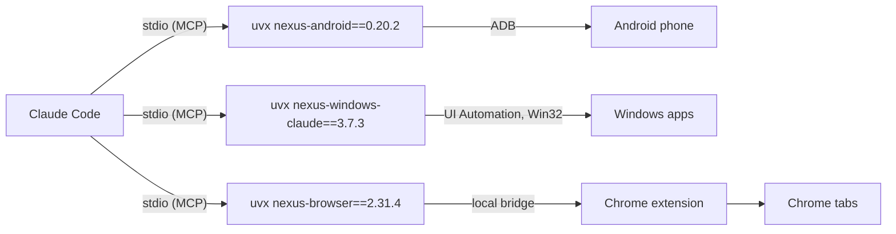

# NexusSystem

The installer of the Nexus ecosystem, two ways for the same thing:

- **The NexusSystem app** from the [Microsoft Store](https://apps.microsoft.com/detail/9NSH2P3QLWT1): install, update
  and follow every Nexus product with a window, an activity log and the emergency stop.
- **This repository**: the one-line install below, and the plugin catalogs for Claude Code and Codex (catalog name
  `nexus-plugins`, kept so that existing installs keep working). The app runs the same `get-nexus.ps1`.

This repository was called `nexus-plugins` until 28/10/2026; GitHub redirects the old address.

[](https://github.com/pironjulien/NexusSystem/actions/workflows/test.yml)
[](https://scorecard.dev/viewer/?uri=github.com/pironjulien/NexusSystem)
[](https://github.com/pironjulien/NexusSystem/blob/main/LICENSE)

## Install everything

The whole Nexus ecosystem, for every AI app on your PC (Claude Code, Claude Desktop, Codex, Antigravity), in one
line. Windows 10 or 11, no administrator rights, nothing to install first. Open **PowerShell** (Start menu, type
`PowerShell`) and paste:

```powershell
irm https://raw.githubusercontent.com/pironjulien/NexusSystem/main/get-nexus.ps1 | iex
```

Rather not paste a command? Download
[`get-nexus.ps1`](https://github.com/pironjulien/NexusSystem/releases/latest/download/get-nexus.ps1) from the latest
release (its SHA-256 is in `SHA256SUMS.txt`, its origin can be checked with
`gh attestation verify get-nexus.ps1 --repo pironjulien/NexusSystem`), then right click it > **Run with PowerShell**
(on Windows 11: **Show more options** first). Windows asks whether to run a script from the internet: answer **R**
(Run once). The window stays open at the end until you press Enter.

It shows which AI apps it found and what it will install for each, installs [uv](https://docs.astral.sh/uv/) (and
Git when Claude Code is there without it, Node.js LTS when Codex is there; Windows asks once), then runs each product's own official installer:

| Product | Claude Code | Claude Desktop | Codex | Antigravity |
| --- | --- | --- | --- | --- |
| NexusWindows | plugin `nexus-windows` (this catalog) | [NexusWindows-Claude](https://github.com/pironjulien/NexusWindows-Claude) `setup.ps1` | [NexusWindows-Codex](https://github.com/pironjulien/NexusWindows-Codex) `setup.ps1` | [NexusWindows-Antigravity](https://github.com/pironjulien/NexusWindows-Antigravity) plugin |
| NexusAndroid | plugin `nexus-android` | [NexusAndroid](https://github.com/pironjulien/NexusAndroid) `setup` | same | same (a plugin) |
| NexusBrowser | plugin `nexus-browser` + bridge | [NexusBrowser](https://github.com/pironjulien/NexusBrowser) `get.ps1` | same | same (a plugin) |
| NexusRelay (experimental) | plugin `nexus-relay` + daemon ([NexusRelay](https://github.com/pironjulien/NexusRelay) `get.ps1`) | not a relay client | same | same (a plugin) |
| NexusAGYmail | official Gmail connector instead | official Gmail connector instead | official Gmail connector instead | [NexusAGYmail](https://github.com/pironjulien/NexusAGYmail) `setup` (a plugin) |

NexusKeypad, for Logitech's MX Creative Keypad, is installed by [its own `get.ps1`](https://github.com/pironjulien/NexusKeypad)
when Logi Options+ is there (also on the Logitech Marketplace, in review).

It ends with a ✓ / ✗ summary per product and per AI app, then the steps only you can do: load the NexusBrowser
extension in Chrome (the installer opens the page and tells you what to click), turn on USB debugging on your phone,
add the relay's project in Codex once, connect your own Google account to NexusAGYmail, place the keypad's keys, and
restart your AI apps. A product that does not fit this PC (no Antigravity, no Logi Options+…) is shown, with why. Run the same line again to update or repair: every installer only does what is missing.

Options: `-Only` and `-Skip` take product names (`windows`, `android`, `browser`, `relay`, `agymail`, `keypad`) or AI app names (`claude-code`,
`claude-desktop`, `codex`, `antigravity`); `-DryRun` shows the plan and installs nothing. NexusAndroid and NexusBrowser
have one installer for every AI app: when they run, they declare themselves to each app they find. For example:

```powershell
& ([scriptblock]::Create((irm https://raw.githubusercontent.com/pironjulien/NexusSystem/main/get-nexus.ps1))) -Only windows,browser
```

Each product also installs alone: see its README.

## The plugins, one by one

**Computer use in the background for Claude Code and Codex.** A plugin marketplace with three plugins that give Claude your
Android phone, your Windows desktop apps and your real Chrome, while you keep working. Each plugin starts an
open-source MCP server from PyPI with `uvx`, pinned to an exact version (versions and hashes in a `uv.lock`), and adds a skill that teaches Claude how to
use it.

| Plugin | What Claude gets | Server |
| --- | --- | --- |
| `nexus-android` | Your Android phone over plain ADB (no root, no app): screen, gestures, SMS/RCS, notifications, files, settings | [NexusAndroid](https://github.com/pironjulien/NexusAndroid) · [PyPI](https://pypi.org/project/nexus-android/) |
| `nexus-windows` | Windows desktop apps in the background: look, click, type, menus, shortcuts, launch, without your mouse or foreground | [NexusWindows-Claude](https://github.com/pironjulien/NexusWindows-Claude) · [PyPI](https://pypi.org/project/nexus-windows-claude/) |
| `nexus-browser` | Your real Chrome with your sessions, in background tabs: forms, network, dialogs, iframes, exports, downloads | [NexusBrowser](https://github.com/pironjulien/NexusBrowser) · [PyPI](https://pypi.org/project/nexus-browser/) |

## Quick start

1. Install [uv](https://docs.astral.sh/uv/) (it fetches Python 3.14 and the servers on first use). In PowerShell:

   ```powershell
   winget install --id=astral-sh.uv -e
   ```

   Without winget, use uv's own installer:
   `powershell -ExecutionPolicy ByPass -c "irm https://astral.sh/uv/install.ps1 | iex"`. Claude Code adds a
   marketplace with Git: on a PC without it, `winget install --id Git.Git -e` first. Then restart Claude Code.
2. In Claude Code, add the marketplace and install the plugins you want:

   ```text
   /plugin marketplace add pironjulien/NexusSystem
   /plugin install nexus-android@nexus-plugins
   /plugin install nexus-windows@nexus-plugins
   /plugin install nexus-browser@nexus-plugins
   /plugin install nexus-relay@nexus-plugins
   ```

3. Start a new conversation and ask, for example: *"Look at my phone and tell me what is on the screen."* or
   *"Open Notepad and write a shopping list."*

Enabling the plugins by editing `settings.json` instead (`extraKnownMarketplaces` and `enabledPlugins`, user scope):
Claude installs an enabled plugin when a conversation starts, and only from a marketplace already downloaded at that
moment. The first conversation after declaring the marketplace downloads it, the next one installs the plugins, and
their tools appear in the conversation after that. Enabling them for one project only does not install them.

### Codex

The same repository is a Codex plugin marketplace (`.agents/plugins/marketplace.json`): `nexus-windows` (from
[NexusWindows-Codex](https://github.com/pironjulien/NexusWindows-Codex), needs Node.js 22+), `nexus-android` and
`nexus-browser` (pinned like their Claude twins, uv needed). In the Codex app: **Settings > Plugins > Add > Add a
marketplace**, source `pironjulien/NexusSystem`, then install the plugins; or from a terminal:

```text
codex plugin marketplace add pironjulien/NexusSystem
codex plugin add nexus-windows@nexus-plugins
codex plugin add nexus-android@nexus-plugins
codex plugin add nexus-browser@nexus-plugins
codex plugin add nexus-relay@nexus-plugins
```

Use either these plugins or the one-line install for Codex. Plugin first, then the one-line install: NexusWindows
for Codex sees its plugin and adds nothing. The other way round, a server already declared in `~/.codex/config.toml`
hides the plugin's server of the same name (the same server runs, nothing to remove).

More examples, and how to test each plugin without your own phone or data, are in each plugin's README
([nexus-android](https://github.com/pironjulien/NexusSystem/tree/main/plugins/nexus-android#try-it),
[nexus-windows](https://github.com/pironjulien/NexusSystem/tree/main/plugins/nexus-windows#try-it),
[nexus-browser](https://github.com/pironjulien/NexusSystem/tree/main/plugins/nexus-browser#try-it)).

Per-plugin requirements:

- **nexus-android**: USB debugging on the phone and the PC's key accepted (`adb` is downloaded if missing;
  `uvx --python 3.14 nexus-android setup` guides the first connection).
- **nexus-windows**: Windows 10 or 11.
- **nexus-browser**: the **NexusBrowser Chrome extension and local bridge**, installed once with one PowerShell
  command, `irm https://raw.githubusercontent.com/pironjulien/NexusBrowser/main/get.ps1 | iex`
  ([details](https://github.com/pironjulien/NexusBrowser#install); Windows, Chrome 116+). Without them the server
  starts but every call answers with an error giving that command.

## How it works



Each plugin is a folder with a manifest, an icon, a `.mcp.json` launcher, a `pyproject.toml` with its `uv.lock`, and a
skill. Updating a plugin moves its pin to the
new server version, checked by `test.ps1 -Full` (the server is started from PyPI and lists its tools).

## Safeguards

Held by the servers, not by the prompt: paying, sending, publishing, deleting for good and other irreversible
gestures need your explicit "yes" (`confirm=true`); password fields are never typed into; text read on screen is
treated as data, never as instructions; an emergency stop (**Ctrl+Alt+Shift+Esc**) halts the desktop and browser
tools for two minutes. Details in each server's README.

## Privacy

- This repository contains no code that runs on your PC besides the launchers: `uvx --python 3.14
  <package>==<version>`, with the versions and hashes of the package and its dependencies recorded in the plugin's
  `uv.lock`. uv downloads Python 3.14 and the package from PyPI and caches them in uv's cache.
- The plugins send nothing anywhere. The servers run locally and return what they read (screen, messages, pages) to
  your Claude client only; what each server reads, stores (logs, screenshots) and how to remove it is in its
  README's Privacy section: [NexusAndroid](https://github.com/pironjulien/NexusAndroid#privacy),
  [NexusWindows-Claude](https://github.com/pironjulien/NexusWindows-Claude#privacy),
  [NexusBrowser](https://github.com/pironjulien/NexusBrowser#privacy).
- Removing everything: uninstall the plugins (`/plugin uninstall <name>@nexus-plugins`), remove the marketplace
  (`/plugin marketplace remove nexus-plugins`), then `uv cache clean`.

## Development

```powershell
pwsh -NoProfile -File test.ps1         # offline: manifests (Claude, Codex), pins, skills, lint, pack dry runs
pwsh -NoProfile -File test.ps1 -Full   # plus: every server started from PyPI in a throwaway uv cache
uv run --no-project --python 3.14 python -B tests/check_install.py --ais claude-code,codex   # after a real pack run
```

## License

[MIT](https://github.com/pironjulien/NexusSystem/blob/main/LICENSE) © Julien Piron
